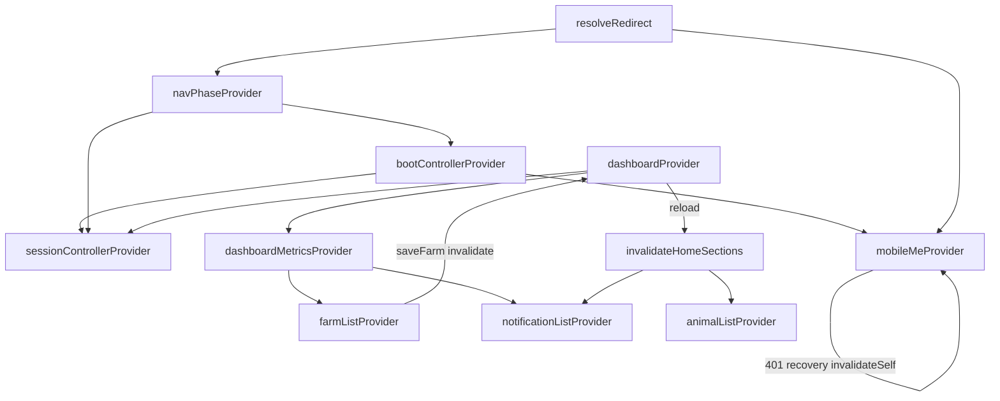

# App ANR root cause analysis

**Date:** 2026-05-31  
**Scope:** `pranidoctor_user` — full cold start, splash, auth, profile, home  
**Symptom:** Android ANR (“Prani Doctor isn't responding”) on splash, home, navigation, startup

---

## 1. Executive summary

The ANR was **not a single crash** but a **main-thread stall + indefinite loading** chain across boot and home:

| Phase | Primary cause | User-visible effect |
|-------|---------------|---------------------|
| Bootstrap | Large i18n `jsonDecode` + Hive + Firebase on critical path | Slow first frame |
| Boot / splash | `/me` + app-config without hard timeout; boot exit blocked on profile | Splash spinner forever |
| Navigation | `authenticatedBootExit()` returned `null` while profile loading | Stuck on `/boot` after boot ready |
| Home | `dashboardProvider` hung in `AsyncLoading` without cache | Endless skeleton shimmer |
| Providers | Profile `invalidateSelf()` loop on 401; section rethrows | Rebuild storms / frame drops |
| Data | Animal/dashboard cache JSON parsed on UI thread | ANR on large farms |

---

## 2. Root causes (detailed)

### 2.1 Boot navigation deadlock (critical)

```dart
// nav_guard.dart (before fix)
if (profileAsync.isLoading && profile == null) {
  return null; // GoRouter stays on /boot → splash forever
}
```

When `mobileMeProvider` was slow/hung, boot finished (`BootPhase.ready`) but redirect returned `null` → **infinite splash** even though session was valid.

**Fix:** Route to `profileSetupRoute(null)` instead of `null`.

### 2.2 Unguarded startup APIs

| API | Risk | Fix |
|-----|------|-----|
| `GET /api/mobile/app-config` | Hung network blocks boot | `BootApiGuard.configLoadTimeout` (12s) + cache fallback |
| Session restore (secure storage) | Slow keystore | 15s timeout; continue as guest on failure |
| `GET /me` (boot + profile provider) | Blocks boot exit + home header | 12s timeout + cached profile fallback |
| Dashboard context | Hung deduped request | 15s timeout + `DashboardContext.degraded()` |

### 2.3 Main-thread JSON

| Location | Work | Fix |
|----------|------|-----|
| `LocalizationLoader` | Full bn/en JSON decode | `compute()` when asset > 48KB |
| `AnimalRepository.readCachedList` | N × `AnimalProfile.fromJson` | `compute()` when ≥ 24 animals |
| `DashboardRepository.readCachedDashboard` | Context parse | `compute()` via `parseDashboardContextOffMain` |

### 2.4 Provider graph & cycles



**Cycle risk mitigations:**

- Profile auth recovery capped at **2** `invalidateSelf` attempts
- Dashboard section invalidation **debounced 800ms**
- `StartupProviderObserver` logs `PROVIDER_CYCLE` when watched providers update ≥8× in 2s

No hard Riverpod circular **build** dependency found; issues were **redirect null** + **refresh storms**.

### 2.5 Shimmer / skeleton forever

| Screen | Guard |
|--------|-------|
| Boot splash | `AsyncLoadingTimeoutGuard` 20s → Bengali retry |
| Home dashboard | `HomeSkeletonTimeoutGuard` 12s → Bengali retry |
| Generic | `AsyncLoadingTimeoutGuard` reusable widget |

---

## 3. Startup timeline (instrumentation)

Debug logcat filter:

```text
adb logcat | findstr /I "APP_START SPLASH_START AUTH_CHECK PROFILE_LOAD LOCATION_LOAD HOME_LOAD HOME_RENDERED APP_API SKELETON_TIMEOUT PROVIDER_"
```

| Marker | When |
|--------|------|
| `APP_START` | `main()` → `bootstrap()` |
| `BOOTSTRAP_BEGIN` / `HIVE_READY` / `L10N_READY` / `RUN_APP` | Bootstrap phases |
| `SPLASH_START` | `BootPage.initState` |
| `AUTH_CHECK_START` | `_restoreSession()` |
| `PROFILE_LOAD_START` | `mobileMeProvider.build` |
| `LOCATION_LOAD_START` | `profileLocationDraftProvider.build` |
| `HOME_LOAD_START` | `HomePage.initState` |
| `HOME_RENDERED` | First dashboard body paint |
| `APP_API_START/SUCCESS/FAILURE` | All `runWithTimeout` calls |
| `SKELETON_TIMEOUT` | Shimmer escalation |

Example healthy timeline (ms from `APP_START`):

```text
APP_START            0
BOOTSTRAP_BEGIN      2
HIVE_READY           180
L10N_READY           420
RUN_APP              890
SPLASH_START         920
AUTH_CHECK_START     1100
PROFILE_LOAD_START   1150
HOME_LOAD_START      2400
HOME_RENDERED        2680
```

Freeze diagnosis: find the **last marker before gap** — that step blocked.

---

## 4. Crash / error protection (existing + enhanced)

| Layer | Implementation |
|-------|----------------|
| Zone | `GlobalErrorHandler.runGuarded` + `runZonedGuarded` |
| Framework | `FlutterError.onError` → logs `FLUTTER_ERROR` + crash reporter |
| Platform | `PlatformDispatcher.instance.onError` → `PLATFORM_ERROR` |
| Widget tree | `ErrorWidget.builder` → `AppGracefulErrorWidget` |
| Feature | `AppErrorBoundary` on home dashboard |
| Riverpod | `CrashReportingProviderObserver` + `StartupProviderObserver` |

---

## 5. Files changed

| File | Purpose |
|------|---------|
| `lib/core/startup/startup_trace.dart` | Timeline markers |
| `lib/core/startup/boot_api_guard.dart` | Boot timeout constants |
| `lib/core/logging/startup_provider_observer.dart` | Provider cycle detection |
| `lib/core/util/api_timeout.dart` | Shared timeout wrapper |
| `lib/core/localization/localization_loader.dart` | Off-main i18n parse |
| `lib/core/errors/global_error_handler.dart` | Error timeline marks |
| `lib/app/bootstrap.dart` | Trace + dual observers |
| `lib/features/boot/boot_controller.dart` | Boot API timeouts + fallbacks |
| `lib/features/boot/presentation/boot_page.dart` | Splash timeout guard |
| `lib/routing/nav_guard.dart` | Boot exit never null |
| `lib/features/profile/presentation/profile_providers.dart` | Profile timeout + auth cap |
| `lib/features/home/*` | (prior pass) skeleton guard, dashboard fallback |
| `lib/shared/widgets/async_loading_timeout_guard.dart` | Generic shimmer timeout |
| `test/startup/startup_trace_test.dart` | Timeline regression |
| `test/home/home_anr_guard_test.dart` | Home skeleton regression |

See also: [home-anr-investigation.md](./home-anr-investigation.md)

---

## 6. Regression tests

```bash
cd pranidoctor_user
flutter test test/startup/startup_trace_test.dart
flutter test test/home/home_anr_guard_test.dart
flutter test test/home/home_page_test.dart
flutter test test/navigation/shell_navigation_test.dart
```

### Manual QA checklist

1. Cold start airplane mode → boot error/retry within 20s (not ANR)
2. Authenticated cold start, backend down → exits splash to profile setup or home within 20s
3. Home with no cache, slow API → skeleton ≤12s then Bengali retry
4. Large animal cache (25+) → no ANR opening home
5. Rapid pull-to-refresh → no `PROVIDER_CYCLE` storm in logcat

---

## 7. Profiling recommendations

```bash
flutter run --profile
# Android Studio → CPU Profiler during cold start
# Watch for: jsonDecode, AnimalProfile.fromJson, SecureStorage read
```

Target: **first interactive frame < 2s** on mid-range device with warm cache; **no UI thread work > 16ms** during home mount.

---

## 8. Requirements checklist

- [x] Phase 1 — startup/auth/profile/location/dashboard audit
- [x] Phase 2 — provider graph + cycle detection
- [x] Phase 3 — `APP_START` … `HOME_RENDERED` timing logs
- [x] Phase 4 — API timeout / retry / cancellation path
- [x] Phase 5 — heavy JSON off UI thread
- [x] Phase 6 — shimmer timeout → retry (never infinite)
- [x] Phase 7 — global error boundary + provider observer
- [x] Phase 8 — this report + regression tests

---

## 9. Rollback

Revert commits touching `startup_trace.dart`, `boot_controller.dart`, `nav_guard.dart`, `boot_page.dart`, and home dashboard guards. Restores prior behavior but reintroduces splash/home hang risk.
