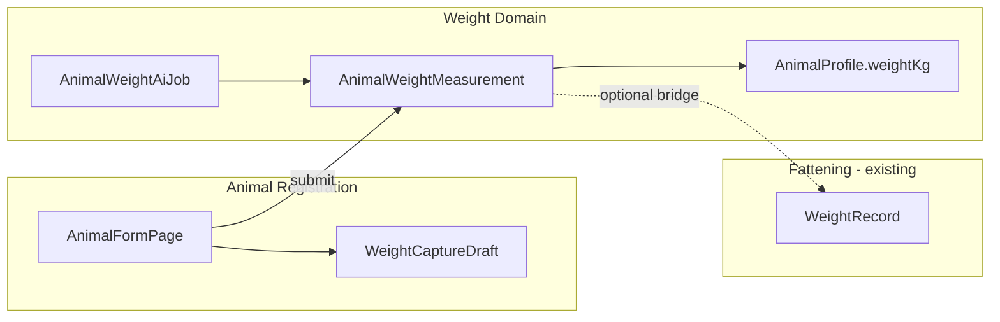
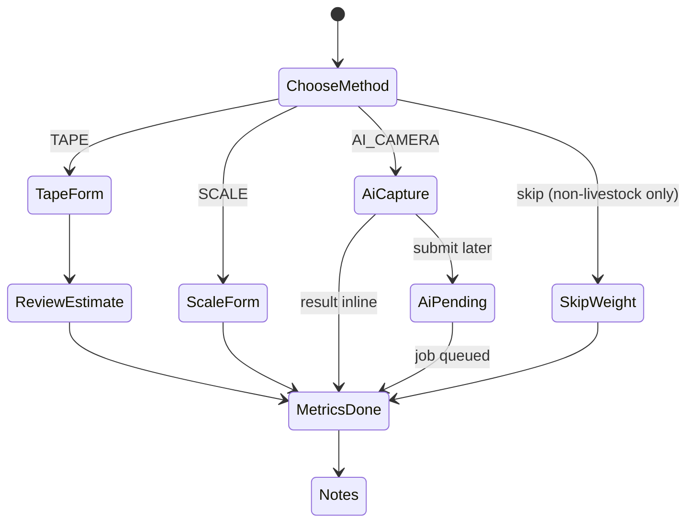
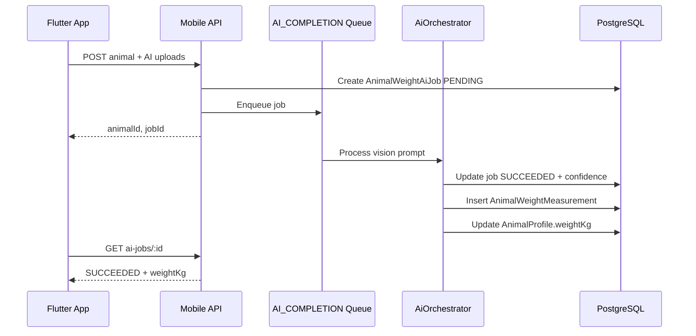

# Animal Registration Weight System — Architecture & Implementation Plan

**Plan ID:** `ANIMAL_REGISTRATION_WEIGHT_SYSTEM_V1`  
**Date:** 2026-05-31  
**Status:** Implemented (2026-05-31)  
**Product:** Prani Doctor User App (Flutter)  
**Platforms:** `pranidoctor_user`, `pranidoctor-backend`, `pranidoctor-web` (BFF proxies only)

**Related (existing):**

- Animal registration: `lib/features/animals/` — 4-step `AnimalFormPage`, Hive draft, `animal_create` / `animal_patch` outbox
- Fattening weight (batch-scoped): `WeightRecord`, `WeightRecordMethod`, Phase 6 plan — `pranidoctor-web/docs/fattening/PHASE6_WEIGHT_PLAN.md`
- Mobile animals API: `/api/mobile/animals`, `AnimalProfile.weightKg`
- AI platform: `src/modules/ai/orchestrator`, `QueueNames.AI_COMPLETION`, `AiUsageRecord`

---

## 1. Executive summary

Today, animal registration captures weight as a single optional **kg number** on step 3 (metrics). There is no structured capture for **tape (heart girth + body length)**, **scale with photo evidence**, or **AI camera/video estimation**. Fattening already has `WeightRecord` with `SCALE` / `TAPE` / `ESTIMATE` / `OTHER`, but it **requires `batchId`** and is optimized for batch progress — not registration.

This plan introduces an **animal-scoped weight measurement domain** used at registration and throughout the animal lifecycle, with three explicit methods, offline-first drafts, async AI jobs, accuracy analytics, audit trails, and a forward-compatible hook for **smart scales**.

| Method | User inputs | System output |
|--------|-------------|---------------|
| **1 — Tape** | Heart girth (cm), body length (cm) | Estimated live weight (kg) + formula metadata |
| **2 — Scale** | Weight (kg), optional scale photo | Recorded weight (kg) |
| **3 — AI camera** | Images and/or short video | AI estimated weight (kg) + confidence score |

`AnimalProfile.weightKg` remains the **denormalized “current weight”** for lists and cards, updated from the **latest accepted measurement** (same philosophy as fattening Phase 6).

---

## 2. Current state (audit)

| Layer | What exists | Gap |
|-------|-------------|-----|
| **DB** | `AnimalProfile.weightKg`; `WeightRecord` (batch + animal, immutable daily unique per batch) | No registration-scoped measurement row; no girth/length; no AI job linkage |
| **API** | `POST/PATCH /api/mobile/animals` accepts optional `weightKg` | No structured weight payload; direct `weightKg` bypasses method/provenance |
| **Flutter** | `AnimalFormPage` step 3: free-text kg only | No method picker, tape fields, scale photo, AI capture |
| **Uploads** | `MobileUploadPurpose.ANIMAL_PHOTO` | No weight-evidence or AI-frame purposes |
| **Offline** | `animal_create` / `animal_patch` outbox; Hive animal draft | Draft has `weightKg` only; no weight sub-document or AI pending state |
| **AI** | Orchestrator, vision-capable providers, `AI_COMPLETION` queue | No `livestock_weight_estimate` feature contract |
| **Audit** | Redis-backed `createAuditLog` | No animal-weight-specific actions |

**Design constraint:** Do **not** make `WeightRecord.batchId` nullable to serve registration — batch uniqueness and fattening dashboards depend on batch scope. Add a **parallel animal-level table** and optionally **bridge** into `WeightRecord` when the animal is in an active fattening batch.

---

## 3. Goals and non-goals

### 3.1 Goals

1. Three registration-grade weight methods with validated inputs and persisted provenance.
2. **Registration flow** integrates weight as a dedicated sub-step (or expanded metrics step) with method selection.
3. **Immutable measurement history** per animal (append-only at API level).
4. **Draft save** includes full weight capture state (method-specific fields, local media URIs).
5. **Offline:** create animal + weight measurement via outbox; AI jobs queued when online.
6. **AI pipeline:** async job, confidence, retry, disclaimer; usage logged.
7. **Accuracy comparison** across methods for the same animal (analytics, not blocking UX).
8. **Audit logs** for create, AI completion, and profile weight mirror updates.
9. **Future smart scale:** extensible device metadata without schema churn.

### 3.2 Non-goals (V1)

- Editing or deleting historical measurements (corrections = compensating admin tool, later).
- Replacing fattening `WeightRecord` or batch dashboards in V1 (bridge in V1.1).
- On-device ML model (server-side vision only for AI method).
- Veterinary diagnosis from weight (display disclaimer only).
- Web farmer UI for weight entry (mobile-first).

---

## 4. Domain model

### 4.1 Concepts



| Concept | Description |
|---------|-------------|
| **Weight capture session** | Logical UX session during registration or “log weight” from animal detail; maps to one `AnimalWeightMeasurement` on submit (or one AI job → measurement on success). |
| **Measurement** | Immutable row: method, inputs, derived kg, evidence URLs, source (`REGISTRATION` \| `ANIMAL_DETAIL` \| `FATTENING_BRIDGE`). |
| **Current weight** | `AnimalProfile.weightKg` = latest measurement by `measuredAt` (tie-break `createdAt`). |
| **AI job** | Async processing for method `AI_CAMERA`; produces measurement on `SUCCEEDED`. |

### 4.2 Relationship to fattening `WeightRecord`

| Event | Behavior (V1) |
|-------|----------------|
| User registers animal with weight | Create `AnimalWeightMeasurement` only; update `AnimalProfile.weightKg`. |
| User logs weight in fattening batch | Keep existing `POST /api/mobile/fattening/weight` → `WeightRecord` (unchanged). |
| **V1.1 bridge** | Optional: on fattening weight create, also insert `AnimalWeightMeasurement` with `source=FATTENING_BRIDGE` and `linkedWeightRecordId`. |
| **V1.1 bridge** | On registration weight, if animal is in exactly one `ACTIVE` batch, optionally mirror to `WeightRecord` for batch charts (config flag, default off). |

---

## 5. Database schema

**Target:** `pranidoctor-backend/prisma/schema.prisma`  
**Migration id (proposed):** `20260610120000_animal_registration_weight_system`

### 5.1 New enums

```prisma
enum AnimalWeightMethod {
  TAPE
  SCALE
  AI_CAMERA
  SMART_SCALE   // reserved — not exposed in V1 UI
}

enum AnimalWeightMeasurementSource {
  REGISTRATION
  ANIMAL_DETAIL
  FATTENING_BRIDGE
  SMART_SCALE     // future
}

enum AnimalWeightAiJobStatus {
  PENDING
  PROCESSING
  SUCCEEDED
  FAILED
  CANCELLED
}
```

**Note:** Fattening `WeightRecordMethod` (`SCALE`, `TAPE`, `ESTIMATE`, `OTHER`) stays separate. Mapping: tape → `TAPE`, scale → `SCALE`, AI → store as `AI_CAMERA` on animal measurement only.

### 5.2 `AnimalWeightMeasurement` (canonical animal-level history)

```prisma
model AnimalWeightMeasurement {
  id              String                        @id @default(cuid())
  customerId      String
  animalId        String
  method          AnimalWeightMethod
  source          AnimalWeightMeasurementSource @default(REGISTRATION)

  /// Canonical weight for this event (kg)
  weightKg        Decimal                       @db.Decimal(10, 3)

  measuredAt      DateTime                      @default(now())
  measuredOn      DateTime                      @db.Date

  // --- Method: TAPE ---
  heartGirthCm    Decimal?                      @db.Decimal(8, 2)
  bodyLengthCm    Decimal?                      @db.Decimal(8, 2)
  tapeFormulaId   String?                       // e.g. "CATTLE_BD_V1", "GOAT_METRIC_V1"
  tapeEstimatedKg Decimal?                      @db.Decimal(10, 3) // pre-round estimate

  // --- Method: SCALE / SMART_SCALE ---
  scalePhotoUrl   String?

  // --- Method: AI_CAMERA ---
  aiJobId         String?                       @unique
  aiConfidence    Decimal?                      @db.Decimal(5, 4) // 0.0000–1.0000
  aiModelId       String?
  aiDisclaimerAck Boolean                       @default(false)

  // --- Evidence (AI / optional) ---
  mediaAssetIds   String[]                      @default([]) // UploadedFile ids

  // --- Future smart scale ---
  deviceVendor    String?
  deviceModel     String?
  deviceReadingId String?
  devicePayload   Json?

  // --- Linkage ---
  linkedWeightRecordId String?                  @unique
  clientMeasurementId  String?                  // idempotency from mobile

  note            String?
  createdAt       DateTime                      @default(now())
  updatedAt       DateTime                      @updatedAt

  customer        CustomerProfile               @relation(fields: [customerId], references: [id], onDelete: Cascade)
  animal          AnimalProfile                 @relation(fields: [animalId], references: [id], onDelete: Cascade)
  aiJob           AnimalWeightAiJob?            @relation(fields: [aiJobId], references: [id])
  linkedWeightRecord WeightRecord?              @relation(fields: [linkedWeightRecordId], references: [id])

  @@unique([customerId, clientMeasurementId])
  @@index([customerId, animalId, measuredAt])
  @@index([animalId, method, measuredOn])
}
```

**Immutability:** No update/delete API in V1; `updatedAt` equals `createdAt` in practice.

**Optional uniqueness (product decision):** At most one registration-sourced measurement per animal per calendar day:

```prisma
@@unique([animalId, source, measuredOn]) // only if source = REGISTRATION — enforce in service layer if partial unique not supported
```

Prefer **service-layer check** for `REGISTRATION` + `measuredOn` to avoid blocking `ANIMAL_DETAIL` re-weighs same day.

### 5.3 `AnimalWeightAiJob`

```prisma
model AnimalWeightAiJob {
  id              String                   @id @default(cuid())
  customerId      String
  animalId        String?                  // null until animal exists (registration offline)
  registrationDraftId String?            // client draft correlation
  status          AnimalWeightAiJobStatus @default(PENDING)
  animalType      AnimalType?              // hint for model routing
  uploadIds       String[]                 @default([])
  videoUploadId   String?
  frameUploadIds  String[]                 @default([])
  resultWeightKg  Decimal?                 @db.Decimal(10, 3)
  confidence      Decimal?                 @db.Decimal(5, 4)
  modelId         String?
  providerId      String?
  errorCode       String?
  errorMessage    String?
  promptVersion   String?
  requestedAt     DateTime                 @default(now())
  startedAt       DateTime?
  completedAt     DateTime?
  createdAt       DateTime                 @default(now())
  updatedAt       DateTime                 @updatedAt

  customer        CustomerProfile          @relation(fields: [customerId], references: [id], onDelete: Cascade)
  measurement     AnimalWeightMeasurement?

  @@index([customerId, status, requestedAt])
  @@index([animalId])
}
```

### 5.4 `AnimalWeightAccuracySnapshot` (comparison / analytics)

Materialized periodically or computed on read in V1; table optional for V1 (service-only). If persisted:

```prisma
model AnimalWeightAccuracySnapshot {
  id                String   @id @default(cuid())
  customerId        String
  animalId          String
  windowStart       DateTime @db.Date
  windowEnd         DateTime @db.Date
  referenceMethod   AnimalWeightMethod  // e.g. SCALE
  referenceKg       Decimal  @db.Decimal(10, 3)
  compareMethod     AnimalWeightMethod
  compareKg         Decimal  @db.Decimal(10, 3)
  deltaKg           Decimal  @db.Decimal(10, 3)
  deltaPercent      Decimal  @db.Decimal(8, 4)
  sampleCount       Int
  computedAt        DateTime @default(now())

  @@index([customerId, animalId, computedAt])
}
```

### 5.5 `AnimalProfile` extensions (minimal)

```prisma
model AnimalProfile {
  // existing fields...
  weightKg              Decimal?  @db.Decimal(10, 3)
  lastWeightMethod      AnimalWeightMethod?
  lastWeightMeasuredAt  DateTime?
  weightMeasurements    AnimalWeightMeasurement[]
}
```

**Policy:** `weightKg` on `POST /api/mobile/animals` becomes **write-on-create only when no `weightCapture` object is sent**; if `weightCapture` is present, server **ignores** bare `weightKg` and derives from measurement transaction.

### 5.6 Upload purposes (additive enum values)

```prisma
enum MobileUploadPurpose {
  // existing...
  ANIMAL_WEIGHT_SCALE_PHOTO
  ANIMAL_WEIGHT_AI_IMAGE
  ANIMAL_WEIGHT_AI_VIDEO
}
```

### 5.7 Tape estimation formulas (server-side registry)

Stored in code (`tape-formula-registry.ts`), not DB, versioned by `tapeFormulaId`:

| `animalType` | Formula (metric) | `tapeFormulaId` | Valid range (cm) |
|--------------|------------------|-----------------|------------------|
| `CATTLE`, `BUFFALO` | \( W = \frac{\text{HG}^2 \times \text{BL}}{10800} \) (cm → kg, common BD cattle tape) | `CATTLE_METRIC_V1` | HG 80–250, BL 100–200 |
| `GOAT`, `SHEEP` | \( W = \frac{\text{HG}^2 \times \text{BL}}{12000} \) | `SMALL_RUMINANT_METRIC_V1` | HG 40–120, BL 40–100 |
| `POULTRY` | Not supported — UI hides tape method | — | — |
| `OTHER` | Fallback to `SMALL_RUMINANT_METRIC_V1` with disclaimer | `GENERIC_METRIC_V1` | Wide bounds + low confidence flag |

Server returns `tapeEstimatedKg` (full precision) and rounds `weightKg` to 3 decimals. UI shows disclaimer: *“এটি আনুমানিক ওজন; স্কেল দিয়ে যাচাই করুন।”*

---

## 6. API endpoints

**Base:** `/api/mobile/animals` and `/api/mobile/animals/:animalId/weight`  
**Auth:** `requireMobileCustomer` (same as animals)  
**Web BFF:** `pranidoctor-web/src/app/api/mobile/animals/**` proxy (mirror fattening weight proxies)

### 6.1 Conventions

| Convention | Value |
|------------|-------|
| JSON | camelCase |
| Decimals | `weightKg` as **string** in JSON (match `AnimalJsonDto`) |
| Errors | `{ "success": false, "error": { "code", "message", "meta"? } }` |
| Idempotency | `clientMeasurementId` header or body field |

### 6.2 Extend animal create / patch

**`POST /api/mobile/animals`**

```json
{
  "animalType": "GOAT",
  "name": "Lalu",
  "weightCapture": {
    "method": "TAPE",
    "heartGirthCm": 72.5,
    "bodyLengthCm": 68.0,
    "measuredAt": "2026-05-31T10:00:00.000Z",
    "clientMeasurementId": "reg-weight-uuid",
    "note": "Morning, standing"
  }
}
```

Alternative methods:

```json
{ "method": "SCALE", "weightKg": 32.5, "scalePhotoUrl": "https://...", "clientMeasurementId": "..." }
```

```json
{
  "method": "AI_CAMERA",
  "uploadIds": ["upload-id-1", "upload-id-2"],
  "videoUploadId": "upload-id-v",
  "aiDisclaimerAck": true,
  "clientMeasurementId": "..."
}
```

For `AI_CAMERA` on create: response may return `animal` + `aiJob: { id, status: "PENDING" }` without final `weightKg` until job completes; `AnimalProfile.weightKg` null until success (or optional user-provided fallback kg disallowed in V1 strict mode).

**`PATCH /api/mobile/animals/:id`** — same `weightCapture` optional block; creates new measurement, updates `weightKg`.

### 6.3 Dedicated weight routes

| Method | Path | Purpose |
|--------|------|---------|
| `POST` | `/api/mobile/animals/:animalId/weight/measurements` | Log weight outside registration |
| `GET` | `/api/mobile/animals/:animalId/weight/measurements` | Paginated history (`page`, `pageSize`, `method?`) |
| `GET` | `/api/mobile/animals/:animalId/weight/current` | Latest measurement + `weightKg` mirror |
| `POST` | `/api/mobile/animals/:animalId/weight/ai-jobs` | Start AI job (detail flow) |
| `GET` | `/api/mobile/animals/:animalId/weight/ai-jobs/:jobId` | Poll status |
| `GET` | `/api/mobile/animals/:animalId/weight/accuracy` | Comparison summary (see §10) |
| `POST` | `/api/mobile/animals/weight/tape/preview` | Server-side estimate without persist (registration UX) |

### 6.4 AI job webhook / poll

- **Poll-only V1:** `GET ai-jobs/:jobId` returns `{ status, resultWeightKg?, confidence?, error? }`.
- **Push V1.1:** FCM when job `SUCCEEDED` / `FAILED`.

### 6.5 Response DTOs

**`AnimalWeightMeasurementDto`**

```json
{
  "id": "clx...",
  "animalId": "clx...",
  "method": "TAPE",
  "source": "REGISTRATION",
  "weightKg": "32.450",
  "measuredAt": "2026-05-31T10:00:00.000Z",
  "measuredOn": "2026-05-31",
  "heartGirthCm": "72.50",
  "bodyLengthCm": "68.00",
  "tapeFormulaId": "SMALL_RUMINANT_METRIC_V1",
  "tapeEstimatedKg": "32.448",
  "scalePhotoUrl": null,
  "aiConfidence": null,
  "mediaAssetIds": [],
  "note": null,
  "createdAt": "..."
}
```

**`AnimalWeightAiJobDto`**

```json
{
  "id": "clx...",
  "status": "PROCESSING",
  "animalId": "clx...",
  "confidence": null,
  "resultWeightKg": null,
  "errorCode": null
}
```

### 6.6 Error codes

| Code | HTTP | When |
|------|------|------|
| `VALIDATION_ERROR` | 422 | Zod / business validation |
| `TAPE_NOT_SUPPORTED` | 422 | Species cannot use tape |
| `WEIGHT_CAPTURE_REQUIRED` | 422 | Livestock registration policy requires weight |
| `DUPLICATE_CLIENT_MEASUREMENT` | 409 | Idempotency replay |
| `AI_JOB_NOT_READY` | 409 | Poll too early |
| `AI_DISCLAIMER_REQUIRED` | 422 | `aiDisclaimerAck` false |
| `STORAGE_NOT_CONFIGURED` | 503 | Upload / evidence missing |

### 6.7 Backend module layout

```
src/modules/animal-weight/
  animal-weight.module.ts
  animal-weight.controller.ts
  animal-weight.service.ts
  animal-weight.validator.ts
  tape-formula-registry.ts
  animal-weight-ai.worker.ts
  animal-weight-accuracy.service.ts
src/legacy/web/routes/mobile/animals/[id]/weight/...
src/legacy/web/lib/mobile-animals/weight-schemas.ts
src/legacy/web/lib/mobile-animals/weight-service.ts
```

---

## 7. Flutter UI flow

**Feature root (proposed):** `lib/features/animals/weight/` (colocated with animals, not fattening)

### 7.1 Registration flow (revise `AnimalFormPage`)

Current steps: Basics → Details → **Metrics** → Notes.

**Target:** Metrics becomes **Weight & age** with substeps:



| Screen | Elements |
|--------|----------|
| **Method chooser** | Three cards: Tape / Scale / AI camera; species-aware (hide tape for poultry); Bengali + English l10n |
| **Tape** | Numeric fields: heart girth, body length (cm); diagram asset; live preview via `tape/preview` API |
| **Scale** | kg field; optional camera → upload `ANIMAL_WEIGHT_SCALE_PHOTO` |
| **AI camera** | Capture 2–5 images and/or ≤15s video; disclaimer checkbox; progress indicator |
| **Review** | Show estimated/entered kg, method badge, edit back |

**State object:** `AnimalWeightCaptureDraft` embedded in `AnimalInput` / `toDraftJson()`:

```dart
class AnimalWeightCaptureDraft {
  AnimalWeightMethod? method;
  double? heartGirthCm;
  double? bodyLengthCm;
  double? scaleWeightKg;
  String? scalePhotoLocalPath;
  String? scalePhotoUrl;
  List<String> aiLocalPaths;
  List<String> aiUploadIds;
  String? aiJobId;
  double? aiResultKg;
  double? aiConfidence;
  bool aiDisclaimerAck;
  String? clientMeasurementId;
}
```

### 7.2 Animal detail — “Log weight”

Route: `/animals/:id/weight/new` — reuses method chooser + forms; calls `POST .../weight/measurements`.

### 7.3 History

Route: `/animals/:id/weight/history` — list measurements, method chips, confidence badge for AI.

### 7.4 Accuracy insights (farmer-facing, simple)

Route: `/animals/:id/weight/accuracy` — “Scale vs tape vs AI” delta cards; link to help doc.

### 7.5 Navigation / routes

Add to `app_routes.dart`:

- `animalWeightHistory(id)`
- `animalWeightNew(id)`
- `animalWeightAccuracy(id)`

Registration stays on existing `animalAdd` / `animalEdit` routes.

### 7.6 UX rules

| Rule | Behavior |
|------|----------|
| Livestock registration | Weight **recommended**; configurable `REQUIRE_WEIGHT_ON_LIVESTOCK` remote flag |
| AI pending on create | Allow save animal; show banner “AI weight processing”; poll job |
| Fattening entry | Unchanged — still `FatteningWeightEntryPage` until bridge ships |
| Unit display | kg only V1; locale formatting |

---

## 8. Validation rules

### 8.1 Shared

| Field | Rule |
|-------|------|
| `weightKg` | `> 0`, `≤ 99999`, max 3 decimal places |
| `measuredAt` | ISO datetime, not > now + 5 min skew |
| `measuredOn` | Derived UTC date; not future |
| `note` | max 2000 chars |
| `clientMeasurementId` | max 120 chars, unique per customer |

### 8.2 Tape

| Field | Rule |
|-------|------|
| `heartGirthCm` | required, 20–300 cm (species-specific bounds enforced) |
| `bodyLengthCm` | required, 20–300 cm |
| `animalType` | `POULTRY`, `CAT`, `DOG` → `TAPE_NOT_SUPPORTED` unless product overrides |

### 8.3 Scale

| Field | Rule |
|-------|------|
| `weightKg` | required |
| `scalePhotoUrl` | optional; HTTPS; same origin policy as `photoUrl` |

### 8.4 AI camera

| Field | Rule |
|-------|------|
| `uploadIds` | 1–5 images **or** `videoUploadId` required |
| Image | max 10 MB each, jpeg/png/webp |
| Video | max 30 MB, ≤15 s (server probe), mp4/webm |
| `aiDisclaimerAck` | must be `true` |
| `confidence` (output) | 0–1; if `< 0.5`, UI shows “low confidence — verify with scale” |

### 8.5 Zod schema location

`src/legacy/web/lib/mobile-animals/weight-schemas.ts` — `weightCaptureSchema`, `createMeasurementSchema`, `aiJobCreateSchema`.

### 8.6 Flutter validators

Extend `AnimalValidation` with `validateHeartGirth`, `validateBodyLength`, `validateWeightCapture(AnimalWeightCaptureDraft)`.

---

## 9. Draft save

### 9.1 Local draft (Hive)

| Key | Content |
|-----|---------|
| `animal_draft` / `animal_edit_draft_{id}` | Extended JSON with `weightCapture` object |

- Autosave on field change (debounced 500 ms) — same as today.
- **Local media:** store `scalePhotoLocalPath`, `aiLocalPaths` in draft; upload on submit or when online mid-draft (background upload queue).

### 9.2 Server draft (optional V1.1)

`AnimalRegistrationDraft` table — **not required V1** if client-only draft suffices.

### 9.3 Submit ordering

```text
1. Upload media (if any) → uploadIds / URLs
2. POST animal with weightCapture OR POST animal then POST measurement
3. If AI_CAMERA: enqueue job; poll until done; update UI
4. clearDraft()
```

Prefer **single transaction** on backend: `createAnimal` + `createMeasurement` in one Prisma transaction.

---

## 10. Offline support

### 10.1 Outbox kinds (additive)

```dart
enum OutboxKind {
  // existing...
  animalWeightMeasurementCreate('animal_weight_measurement_create'),
  animalWeightAiJobCreate('animal_weight_ai_job_create'),
}
```

### 10.2 `animal_create` payload extension

When offline queue creates animal, include serialized `weightCapture` in payload (without AI job unless uploads already synced).

| Method | Offline behavior |
|--------|------------------|
| **TAPE** | Full offline — server computes formula on sync |
| **SCALE** | Offline if kg present; photo optional (local path → upload before drain) |
| **AI_CAMERA** | Queue `animal_create` without final kg; queue `animal_weight_ai_job_create` after animal id assigned OR block AI until online (product: **queue job after sync**, show “will process when online”) |

### 10.3 Idempotency keys

| Operation | Key pattern |
|-----------|-------------|
| Measurement | `awm-{clientMeasurementId}` |
| AI job | `awj-{clientMeasurementId}` |
| Animal create | existing `animal-create-{sequence}` |

### 10.4 Cache

| Key | TTL |
|-----|-----|
| `animal_weight_history_{animalId}` | 24h |
| `animal_weight_current_{animalId}` | 24h |

Invalidate via `sync_invalidation.dart` on successful drain.

### 10.5 Conflict handling

| Server | Client |
|--------|--------|
| `409 DUPLICATE_CLIENT_MEASUREMENT` | Treat as success; merge id |
| AI job failed | Show retry; do not delete animal |

---

## 11. AI processing pipeline

### 11.1 Feature definition

| Property | Value |
|----------|-------|
| Feature key | `livestock_weight_estimate` |
| Request type | `IMAGE_ANALYSIS` (or new `LIVESTOCK_WEIGHT_VISION`) |
| Priority | Medium |
| Timeout | 120 s |
| Models | Vision-capable route via AI router; species hint from `animalType` |

### 11.2 Pipeline steps



### 11.3 Prompt contract (outline)

**System:** Veterinary livestock assistant; estimate live body weight in kg from images/video; Bangladesh context; no diagnosis.

**User payload:** `animalType`, `breed?`, image URLs, optional video key frames.

**Structured output (JSON):**

```json
{
  "weightKg": 31.2,
  "confidence": 0.78,
  "reasoningBrief": "Adult goat, moderate frame",
  "disclaimer": "AI estimate — confirm with scale"
}
```

Validate with zod; reject if `weightKg` out of species bounds.

### 11.4 Governance

- Log via `AiUsageRecord` / `ai-usage.service.ts`
- Feature flag: `AI_LIVESTOCK_WEIGHT_ENABLED`
- Rate limit per customer per day
- Prompt injection scan on any text `note` passed to model (reuse `ai-prompt-security.service.ts`)

### 11.5 Worker

`animal-weight-ai.worker.ts` subscribed to `QueueNames.AI_COMPLETION` with job name `animal_weight_estimate`.

---

## 12. Future smart scale integration

### 12.1 Design (no V1 UI)

- `AnimalWeightMethod.SMART_SCALE`
- BLE/Wi-Fi adapter in Flutter (`lib/features/animals/weight/devices/`) — pluggable `WeightDeviceAdapter`
- Ingest reading: `{ vendor, model, readingId, rawPayload, weightKg, measuredAt }`
- Optional auto-link to fattening batch weigh-in

### 12.2 API (future)

`POST /api/mobile/animals/:id/weight/smart-scale/readings` with HMAC-signed device payload.

### 12.3 Pairing flow (future)

Scan QR on scale → store `CustomerDevice` linkage — out of scope V1; schema `devicePayload` JSON ready.

---

## 13. Accuracy comparison system

### 13.1 Purpose

Help farmers understand deviation between **tape**, **scale** (reference), and **AI** over time — not for billing or legal certification.

### 13.2 Reference method

**Scale (`SCALE`)** is default reference when present within comparison window.

### 13.3 Comparison window

Rolling **90 days** per animal; minimum **2 measurements** with different methods.

### 13.4 Metrics (per animal, per method pair)

| Metric | Formula |
|--------|---------|
| `deltaKg` | `compareKg - referenceKg` |
| `deltaPercent` | `deltaKg / referenceKg * 100` |
| `mae` | mean absolute error across samples |
| `sampleCount` | paired observations count |

### 13.5 API

`GET /api/mobile/animals/:animalId/weight/accuracy`

```json
{
  "animalId": "clx...",
  "referenceMethod": "SCALE",
  "windowDays": 90,
  "pairs": [
    {
      "compareMethod": "TAPE",
      "sampleCount": 4,
      "meanDeltaKg": "1.200",
      "meanDeltaPercent": "3.85",
      "lastComparedAt": "2026-05-20"
    },
    {
      "compareMethod": "AI_CAMERA",
      "sampleCount": 2,
      "meanDeltaKg": "-2.100",
      "meanDeltaPercent": "-6.40",
      "lastComparedAt": "2026-05-18"
    }
  ],
  "disclaimer": "Comparisons are informational only."
}
```

### 13.6 Admin analytics (V2)

Aggregate MAE by `animalType`, region, formula version — feed product tuning.

---

## 14. Audit logs

### 14.1 New audit actions

Add to `audit.types.ts` `AuditAction` union:

| Action | Severity | When |
|--------|----------|------|
| `ANIMAL_WEIGHT_MEASUREMENT_CREATED` | INFO | Successful measurement insert |
| `ANIMAL_WEIGHT_PROFILE_MIRROR_UPDATED` | INFO | `AnimalProfile.weightKg` changed |
| `ANIMAL_WEIGHT_AI_JOB_STARTED` | INFO | Job enqueued |
| `ANIMAL_WEIGHT_AI_JOB_COMPLETED` | INFO | Job succeeded |
| `ANIMAL_WEIGHT_AI_JOB_FAILED` | WARNING | Job failed |
| `ANIMAL_WEIGHT_TAPE_PREVIEW` | INFO | Optional high-volume — sample 1% or skip |

### 14.2 Log payload (`details`)

```json
{
  "animalId": "...",
  "measurementId": "...",
  "method": "TAPE",
  "weightKg": "32.450",
  "source": "REGISTRATION",
  "aiConfidence": null,
  "tapeFormulaId": "SMALL_RUMINANT_METRIC_V1"
}
```

**Never log:** full `devicePayload` secrets, raw image bytes.

### 14.3 Actor

`actorType: CUSTOMER`, `actorId: userId`, `targetType: AnimalProfile`, `targetId: animalId`.

---

## 15. Security & privacy

| Topic | Control |
|-------|---------|
| Authorization | All queries scoped `customerId` from JWT |
| Media | Upload owner = customer user; signed URLs TTL |
| AI output | Disclaimer in app + stored `aiDisclaimerAck` |
| PII | Weight history export subject to data export policy |
| Direct `weightKg` patch | Deprecate direct writes when measurement policy enabled |

---

## 16. Implementation phases

### Phase 1 — Foundation (backend + schema)

1. Prisma migration: enums, `AnimalWeightMeasurement`, `AnimalWeightAiJob`, upload purposes.
2. `tape-formula-registry.ts` + preview endpoint.
3. `weight-service.ts`: create measurement, mirror `AnimalProfile.weightKg`, audit.
4. Extend `createAnimalForCustomer` with `weightCapture` transaction.
5. Zod schemas + mobile routes + web proxies.
6. Unit tests: formula bounds, idempotency, species rules.

### Phase 2 — Flutter registration UX

1. `AnimalWeightCaptureDraft` + draft JSON migration (version field).
2. Method chooser + tape/scale/AI screens.
3. Extend `AnimalFormPage` step 3.
4. `AnimalValidation` + l10n (en/bn).
5. Upload integration for scale/AI media.

### Phase 3 — Offline & sync

1. Outbox kinds + drain handlers in sync service.
2. Payload versioning for `animal_create`.
3. Cache keys + invalidation.
4. Integration tests: offline tape → sync → history.

### Phase 4 — AI pipeline

1. Feature flag + orchestrator route.
2. Worker + job poll API.
3. Flutter poll UI + registration pending banner.
4. Usage logging + admin feature toggle (ai-ops).

### Phase 5 — Accuracy & polish

1. `animal-weight-accuracy.service.ts` + GET accuracy.
2. History + accuracy screens on animal detail.
3. Optional `AnimalWeightAccuracySnapshot` nightly job.

### Phase 6 — Fattening bridge (V1.1)

1. Optional mirror registration → `WeightRecord` when in active batch.
2. Fattening create → `AnimalWeightMeasurement` backfill.
3. Unified timeline API (measurement + batch record).

### Phase 7 — Smart scale (future)

1. Device adapters + signed ingest API.
2. `SMART_SCALE` method exposed in UI.

---

## 17. Testing & verification checklist

| # | Scenario |
|---|----------|
| 1 | Register goat with tape → `weightKg` matches formula ± rounding |
| 2 | Register cattle with scale + photo → URL stored, measurement `SCALE` |
| 3 | Register with AI → job async → profile updated on success |
| 4 | Offline tape registration → outbox drain → server history |
| 5 | Duplicate `clientMeasurementId` → 409 → client idempotent success |
| 6 | Poultry registration → tape hidden; scale works |
| 7 | AI low confidence → UI warning, measurement still stored |
| 8 | Accuracy endpoint with 3 methods → sensible deltas |
| 9 | Audit entries present in Redis for create + AI complete |
| 10 | Fattening weight unchanged regression |

---

## 18. Risks & mitigations

| Risk | Mitigation |
|------|------------|
| Tape formula inaccuracy | Show estimate disclaimer; accuracy dashboard; regional formula versions |
| AI cost / abuse | Rate limits, feature flag, max uploads per job |
| Dual weight sources (animal vs batch) | Clear UX labels; bridge phase documented |
| Large video upload on poor networks | Compress on device; allow image-only fallback |
| Offline AI expectations | Explicit “processes when online” copy |
| Schema drift with `WeightRecordMethod` | Separate enums; explicit mapper |

---

## 19. Open product decisions (resolve before Phase 1 coding)

1. **Require weight** on livestock registration or optional with nudge?
2. **AI on create:** block submit until job completes vs allow animal without `weightKg` initially?
3. **One measurement per registration day** enforced or allow multiple?
4. **Bare `weightKg` on API** deprecated immediately or dual-write transition period?
5. **Bridge to fattening** in V1 or V1.1 only?

---

## 20. File touch list (implementation reference)

| Repo | Paths |
|------|-------|
| `pranidoctor-backend` | `prisma/schema.prisma`, `src/legacy/web/lib/mobile-animals/*`, `src/legacy/web/routes/mobile/animals/**`, `src/modules/animal-weight/**`, `src/modules/ai/**` (feature route), `src/shared/security/audit/audit.types.ts` |
| `pranidoctor-web` | `src/app/api/mobile/animals/**/weight/**` proxies |
| `pranidoctor_user` | `lib/features/animals/**`, `lib/features/animals/weight/**`, `lib/features/offline/data/outbox_item.dart`, `assets/i18n/*.json`, `lib/routing/app_routes.dart` |

---

*End of plan — planning only; no runtime behavior changed by this document.*
