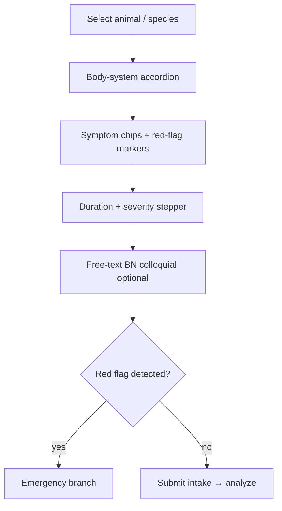

# Phase 6G — Mobile AI Doctor Architecture

**Project:** Prani Doctor Flutter App (`pranidoctor_user`)  
**Role:** Principal Mobile Veterinary AI Architect  
**Date:** 2026-05-31  
**Status:** Architecture only — no implementation  
**Version:** 1.0.0  

**Depends on:**

- `pranidoctor-backend/docs/plans/phase-6d-ai-doctor.md` — case model, orchestrator, confidence, escalation (6D.1e implemented)
- `pranidoctor-backend/docs/plans/phase-6e2-vector-retrieval-expansion.md` — hybrid retrieval, graph pin, GSE p@4 ≥ 0.75
- `pranidoctor-backend/docs/reports/phase-6e2-retrieval-recertification.md` — certification gates and corpus state
- `pranidoctor_user/docs/plans/USER_APP_17_AI_PLAN.md` — legacy chat/triage/offline baseline
- `pranidoctor_user/docs/phase-8-ai-smart-ecosystem-master-plan.md` — symptom checker, farm health, phase-8 APIs

**Parent scope:** This document defines the **farmer mobile product architecture** for AI Doctor. Backend orchestration, VRE, and vet inbox remain in backend/web plans.

---

## Repositories in scope

| Repo | Role |
|------|------|
| `pranidoctor_user` | Symptom intake UI, case-bound chat, emergency UX, escalation, history, confidence/citation/safety presentation |
| `pranidoctor-backend` | Case APIs (`/api/ai/doctor/cases/*`), symptom taxonomy, analyze/escalate orchestration |
| `pranidoctor-web` | Vet escalation inbox, case replay (handoff destination — mobile consumes status only) |

---

## Executive summary

Phase 6G upgrades the Flutter app from **generic AI chat + standalone symptom check** to a **case-centric AI Doctor journey** aligned with the backend 6D.1 orchestrator. Farmers progress through structured symptom intake, grounded differential review, confidence-aware messaging, and auditable vet escalation — with emergency paths that bypass unsafe LLM output.

### Design pillars

1. **Case-first, not chat-first** — every clinical session binds to `AiDoctorCase` + optional livestock.
2. **Grounding visible** — citations and confidence tiers are first-class UI, not footnotes.
3. **Safety never optional** — disclaimers, escalation strips, and BLOCK states are shell-level, not per-widget optional.
4. **Progressive disclosure** — structured intake before free chat; emergency UI above the fold.
5. **Offline-tolerant, safety-conservative** — queue intake locally; never show synthetic clinical answers offline.

### Current vs target

| Capability | Today (Flutter) | Target (6G) |
|------------|-----------------|-------------|
| Symptom entry | Phase-8 taxonomy checkbox page + chat free-text triage | Unified intake wizard → case binding |
| AI conversation | `POST /api/ai/chat` session messages | Case-bound chat via analyze + follow-up turns |
| Emergency | Compliance keyword banners; no dedicated flow | CRITICAL gate → emergency screen → handoff |
| Vet escalation | `requestAiHumanReview`, `/api/ai/escalate` | Typed escalation (`VET_CALL_NOW`, booking, async) |
| Case handoff | None | Case summary + pack citations → vet inbox |
| History | Single-session `aiChatProvider` + local cache | Case list + per-case timeline + resume |
| Confidence | Implicit in compliance metadata | Explicit tier badge (Strong / Moderate / Limited / Insufficient) |
| Citations | Not rendered in chat bubbles | Inline tokens + expandable source cards |
| Safety messaging | `AiComplianceShell`, disclaimer gate, escalation strip | Surface-aware policy matrix + degraded-mode copy |

**Backend prerequisite:** 6D.1 case APIs are **implemented**. Mobile integration is the primary 6G deliverable (extends pending 6D.1f).

---

## Information architecture

### Entry points

```
Home Care Action Bar
    ├── AI Doctor Home (hub)
    │     ├── Start new case (select animal)
    │     ├── Resume active case
    │     └── Past cases / history
    ├── Symptom Checker (fast path → case)
    └── Emergency (red entry — skips non-urgent steps)

Animal Detail → "Ask AI Doctor about this animal"
Health Record → "Get AI guidance" (prefilled context)
```

### Route map (proposed)

| Route | Screen | Purpose |
|-------|--------|---------|
| `/ai` | `AiDoctorHomePage` | Hub, consent gate, active case card |
| `/ai/case/new` | `AiDoctorCaseSetupPage` | Species/livestock selection |
| `/ai/case/:id/intake` | `AiDoctorIntakePage` | Structured symptom wizard |
| `/ai/case/:id/chat` | `AiDoctorChatPage` | Case-bound conversation |
| `/ai/case/:id/result` | `AiDoctorResultPage` | Differential cards + confidence |
| `/ai/case/:id/emergency` | `AiDoctorEmergencyPage` | CRITICAL triage (no LLM) |
| `/ai/case/:id/escalate` | `AiDoctorEscalationPage` | Vet channel selection |
| `/ai/history` | `AiDoctorHistoryPage` | Case list (replaces session-only history) |
| `/ai/symptom-check` | `SymptomCheckerPage` | Retained; outputs `symptomCheckSessionId` |

Existing routes (`/home/ai-chat`, `/ai/settings`) remain during migration with deprecation shims.

---

## Layered mobile architecture

```
┌─────────────────────────────────────────────────────────────┐
│  Presentation — pages, widgets, compliance shell            │
│    AiDoctorChatPage, DifferentialCard, ConfidenceBadge, …   │
├─────────────────────────────────────────────────────────────┤
│  Application state — Riverpod notifiers                     │
│    aiDoctorCaseProvider, aiDoctorChatProvider, …            │
├─────────────────────────────────────────────────────────────┤
│  Domain — case lifecycle, UI view models                    │
│    AiDoctorCaseVm, IntakeStep, EscalationAction             │
├─────────────────────────────────────────────────────────────┤
│  Data — repository, DTOs, offline outbox                    │
│    AiDoctorRepository, Hive/Drift cache                     │
├─────────────────────────────────────────────────────────────┤
│  Transport — Dio + authMobile interceptor                   │
│    /api/ai/doctor/cases/*, /api/ai/symptom-*                │
└─────────────────────────────────────────────────────────────┘
```

**State management:** Extend existing **Riverpod** (`AsyncNotifierProvider`) patterns from `lib/features/ai/presentation/ai_providers.dart`. Case state is authoritative from server; local cache is a projection for offline read and outbox replay.

**Feature module layout (proposed):**

```
lib/features/ai_doctor/
  data/          ai_doctor_repository.dart, ai_doctor_dto.dart, ai_doctor_api_paths.dart
  domain/        ai_doctor_case_state.dart, confidence_tier.dart
  presentation/
    pages/       intake, chat, result, emergency, escalation, history
    widgets/     differential_card, citation_chip, confidence_badge, risk_banner
    providers/   case, chat, history notifiers
```

Legacy `lib/features/ai/` remains for farm health, smart alerts, and generic chat until cutover.

---

## 1. Symptom Checker UI

### Purpose

Structured, body-system-organized symptom selection that feeds the AI Doctor case model — not a standalone diagnosis tool.

### UX flow



### Screen composition

| Zone | Component | Behavior |
|------|-----------|----------|
| Header | `RiskBanner` (hidden until flags) | Shows when taxonomy marks `redFlag: true` |
| Body | Body-system sections from `GET /api/ai/symptom-taxonomy` | Checkbox chips; BN primary, EN subtitle optional |
| Footer | Duration picker (days), severity segmented control | Required before analyze when completeness &lt; 0.60 |
| FAB | Voice input | Fills free-text field via existing `SpeechService` |
| Bottom | "Continue" | Validates ≥1 symptom; creates case if none exists |

### Integration with backend

| Step | API | Notes |
|------|-----|-------|
| Load taxonomy | `GET /api/ai/symptom-taxonomy?species=` | Reuse `SymptomCheckerPage` data layer |
| Optional quick check | `POST /api/ai/symptom-check` | Rules-only pre-screen; **does not replace** case analyze |
| Create case | `POST /api/ai/doctor/cases` | Pass `symptomCheckSessionId` when coming from checker |
| Submit intake | `POST /api/ai/doctor/cases/:id/intake` | Structured codes + free text + duration + severity |

### Design rules

- **Never label output as diagnosis** — copy: "Possible conditions to discuss with your vet."
- Red-flag symptoms use **persistent red border + icon**; selecting any triggers emergency pre-check on submit.
- Colloquial BN input shows **expanded canonical terms** in helper text (matches VRE colloquial map).
- Intake survives **app backgrounding** — persist draft to local store keyed by `caseId`.

### Reuse from existing code

- `SymptomCheckerPage` taxonomy rendering
- `AiCompliancePageBody` with `AiComplianceSurface.symptomCheck`
- `AiValidation.validateSymptoms`

---

## 2. AI Doctor Chat

### Purpose

Multi-turn, case-bound conversation surface where each assistant turn reflects **analyze orchestrator output** — differentials, confidence, citations, and safety flags — not raw LLM streaming alone.

### Conversation model

| Message type | Source | Rendering |
|--------------|--------|-------------|
| `USER` | Farmer text/voice | Standard bubble (existing `AiMessageBubble`) |
| `ASSISTANT_ANALYSIS` | `analyze` response | Composite card: summary text + differential strip + confidence + citations |
| `ASSISTANT_CLARIFICATION` | Intake completeness | Question chips from `clarificationQuestions[]` |
| `SYSTEM_SAFETY` | BLOCK / refuse | Non-dismissable safety card + vet CTA |
| `SYSTEM_HANDOFF` | Emergency / escalation | Transition message with action buttons |

### Turn sequence

```
1. Case created → INTAKE
2. Intake submitted → completeness check
3. If AWAITING_CLARIFICATION → render clarification chips in chat
4. When ready → POST analyze
5. Render AnalyzeCaseResult as structured assistant message
6. Follow-up user messages → POST /api/ai/assistants/ai-doctor (session transport) OR re-analyze with updated intake
```

### Chat layout

```
┌──────────────────────────────────────┐
│ RiskBanner (urgency tier)            │
│ ConfidenceBadge                      │
├──────────────────────────────────────┤
│ Message list (scroll)                │
│   [User bubble]                      │
│   [AssistantAnalysisCard]            │
│     ├─ summary text                  │
│     ├─ DifferentialCard × N          │
│     └─ CitationExpandable            │
├──────────────────────────────────────┤
│ AiDisclaimerBanner (persistent)      │
│ AiEscalationDisclosureStrip          │
├──────────────────────────────────────┤
│ Input + mic + "Talk to vet" chip     │
└──────────────────────────────────────┘
```

### API mapping

| Action | Endpoint | When |
|--------|----------|------|
| Create / load case | `POST/GET /api/ai/doctor/cases/:id` | Session start / resume |
| Intake update | `POST .../intake` | Before each analyze |
| Analyze | `POST .../analyze` | After sufficient completeness |
| Follow-up turn | `POST /api/ai/assistants/ai-doctor` | Mid-case chat (existing gateway) |
| History | `GET /api/ai/history?caseId=` | **New backend field** — extend 6D.1f |

### Non-goals

- No streaming UI in 6G v1 (backend has no SSE stream); show typing indicator during analyze.
- No autonomous prescription rendering in chat — treatment intent triggers escalation handoff.

---

## 3. Emergency Flow

### Purpose

When backend sets `urgencyTier: CRITICAL` or `emergencyHandoff: true`, the app **must not** present LLM clinical prose as primary content. Farmer gets immediate, actionable emergency guidance and vet channels.

### Trigger matrix

| Signal | Backend field | Mobile response |
|--------|---------------|-----------------|
| Red-flag symptom graph hit | `riskAssessment.emergency` | Route to `AiDoctorEmergencyPage` |
| CRITICAL urgency | `urgencyTier: CRITICAL` | Full-screen emergency UI |
| Emergency assistant handoff | `emergencyHandoff: true` | Banner + optional assistant switch |
| User emergency entry | Home red button | Skip intake optional; force emergency profile |

### Emergency screen layout

```
┌──────────────────────────────────────┐
│ ⚠️  জরুরি — এখনই পশুচিকিৎসকের সহায়তা │
├──────────────────────────────────────┤
│ Immediate actions (BN numbered list) │
│   from riskAssessment.recommendationBn│
├──────────────────────────────────────┤
│ [Call vet now]  [Find nearby clinic] │
│ [Share case summary]                 │
├──────────────────────────────────────┤
│ Collapsed: what NOT to do            │
│ Legal: emergency limitation acceptance │
└──────────────────────────────────────┘
```

### Integration

- Reuse `emergency_limitation` feature for contextual urgent copy (`EmergencyLimitationBundle`).
- Emergency page sets case state visual to `EMERGENCY_TRIAGE` (read-only from server).
- **No analyze retry** on emergency page until user confirms "situation stabilized" (explicit tap — avoids accidental LLM invocation).

### Safety

- Haptic + high-contrast red theme (accessible, not alarm-only color).
- Back navigation shows confirm dialog: "Emergency guidance may still be needed."

---

## 4. Vet Escalation

### Purpose

Typed, auditable paths from AI Doctor case to licensed veterinary care — triggered automatically or by farmer request.

### Escalation types (maps to backend `EscalationType`)

| Type | Farmer label (BN) | Mobile action |
|------|-------------------|---------------|
| `VET_CALL_NOW` | এখনই কল করুন | `tel:` deeplink / in-app dialer |
| `VET_BOOKING` | অ্যাপointment বুক করুন | Navigate `AppRoutes.bookConsultation` with case context |
| `ASYNC_VET_REVIEW` | ভেটের কাছে পাঠান | Submit case summary; show pending status |
| `CLINIC_FINDER` | কাছের ক্লিনিক | Map / location services |

### Trigger surfacing

| Trigger | UI placement |
|---------|--------------|
| `RED_FLAG_SYMPTOM` | Emergency page primary CTA |
| `RETRIEVAL_FAIL_CLOSED` | BLOCK card + async review default |
| `LOW_CONFIDENCE_DEGRADED` | Confidence badge + nudge strip |
| `USER_REQUESTED_VET` | Persistent FAB on chat (R2+ sessions) |
| `TREATMENT_INTENT` | Redirect to escalation; block dose display |
| `POLICY_REFUSAL` | Safety card + booking CTA |

### Escalation page

- Shows **case summary** (species, symptoms, top differentials, confidence tier).
- Farmer selects channel (when not auto-typed).
- `POST /api/ai/doctor/cases/:id/escalate` → display confirmation + reference ID.
- Optional: poll escalation status (future web inbox webhook → push notification).

### Existing reuse

- `requestAiHumanReview(ref)` from `AiMessageBubble`
- `AiEscalationDisclosureStrip`, `ai_escalation_disclosure_providers`
- Doctors module: `book_consultation_page.dart`

---

## 5. Case Handoff

### Purpose

Package the AI Doctor case for vet consumption — structured summary, citations, and symptom snapshot — without exposing raw farmer free text beyond policy.

### Handoff payload (mobile prepares; backend persists)

| Field | Source |
|-------|--------|
| `caseId` | `AiDoctorCase.id` |
| `livestockId` / animal tag | Case + local animal registry |
| `symptomSnapshot` | Intake engine snapshot |
| `differentials[]` | Top 3 `GroundedDifferential` with citations |
| `confidence.tier` | Case confidence tier |
| `packId` | VRE pack reference for vet replay |
| `escalationType` | Selected escalation channel |
| `farmerLocale` | `bn` / `en` |

### Mobile handoff UX

1. Farmer taps "Send to vet" → review screen (editable note optional, max 280 chars).
2. Confirm disclaimer: "This is AI-assisted information, not a diagnosis."
3. Submit → success state with tracking ID + expected response time.
4. Deep link vet side: `pranidoctor-web` inbox (out of scope for Flutter implementation).

### Case state transitions

```
RESPONSE_DELIVERED → ESCALATED (on successful handoff)
BLOCK → ESCALATED (async review still allowed)
EMERGENCY_TRIAGE → ESCALATED (parallel to emergency actions)
```

### Continuity

- Handoff does **not** close the case — farmer can return to chat unless `CLOSED`.
- Vet response (future) appears as `SYSTEM` message or push notification → case update.

---

## 6. AI Conversation History

### Purpose

Farmers review past AI Doctor cases per animal and resume incomplete sessions — replacing single global chat session history.

### Data model (mobile view)

```dart
AiDoctorCaseSummary {
  caseId, livestockId, species, state, urgencyTier,
  confidenceTier, topDifferentialTitle, createdAt, updatedAt,
  hasEscalation, messageCount
}
```

### History UI

| View | Content |
|------|---------|
| **Case list** | Grouped by date; filter by animal / active / escalated |
| **Case detail timeline** | Intake events → analyze results → chat turns → escalations |
| **Resume** | Active cases (`INTAKE`, `AWAITING_CLARIFICATION`, `RESPONSE_DELIVERED`) open chat |

### Storage strategy

| Layer | Responsibility |
|-------|----------------|
| Server | Authoritative case + messages (extend history API with `caseId`) |
| Local Hive/Drift | Case summaries + last 20 messages per case for offline read |
| Outbox | Pending intake/analyze/escalate ops (existing AI outbox pattern) |

### Migration from current `AiHistoryPage`

- Phase 6G.a: Add case list tab alongside legacy session view.
- Phase 6G.b: Deprecate session-only history when case API coverage complete.

### Retention

- Align with backend policy: **24 months** minimum; local cache TTL 90 days (configurable).

---

## 7. AI Confidence Display

### Purpose

Make evidence strength transparent using backend `ConfidenceTier` — farmers always know how much to trust the guidance.

### Tier mapping (from 6D.1)

| Tier | Numeric | Badge (BN) | Color token |
|------|---------|------------|-------------|
| `STRONG` | ≥ 0.70 | শক্ত প্রমাণ | `success` |
| `MODERATE` | 0.50–0.69 | মাঝারি প্রমাণ | `warning` |
| `LIMITED` | 0.35–0.49 | সীমিত তথ্য | `orange` |
| `INSUFFICIENT` | &lt; 0.35 | পর্যাপ্ত তথ্য নেই | `error` |

### Placement rules

| Surface | Display |
|---------|---------|
| Chat header | `ConfidenceBadge` — always on assistant analysis turns |
| Result page | Large badge + one-line explanation |
| Differential card | Per-slug micro-score (optional expand) |
| BLOCK state | Replace badge with "Insufficient evidence" — hide numeric score |

### Degraded mode (`failClosed: true` or `PROCEED_DEGRADED`)

- Show additional line: "চিকিৎসক নিশ্চিত করা গুরুত্বপূর্ণ."
- Auto-surface escalation nudge when tier is `LIMITED` or below.

### Accessibility

- Badge includes semantic label for screen readers (not color-only).
- Tooltip / info icon explains tiers in plain BN.

---

## 8. Citation Display

### Purpose

Surface VKL grounding so farmers (and vets) can see **where** information comes from — mandatory for clinical credibility.

### Citation sources (from `AnalyzeCaseResult`)

| Source | Mobile rendering |
|--------|------------------|
| `differentials[].citations[]` | Inline superscript tokens in summary text |
| `pack.citationBlock` | Expandable "Sources" section |
| `pack.chunks[]` | Source cards: title BN, evidence level, snippet |

### Components

```
CitationChip          — compact [1] [2] pills in summary
CitationBottomSheet   — full chunk list on tap
DifferentialCard      — slug title + evidence level badge + citation chips
SourceTrustRow        — L1/L2/L3 indicator + vet-approved icon if applicable
```

### Interaction

- Tap citation → bottom sheet with chunk `contentBn` (truncated) + link to knowledge detail (`/ai/knowledge/:slug`) when published.
- Long-press → copy citation token for vet handoff.
- When `citations.length == 0` for a differential → **do not render** that differential (backend should filter; mobile defensive).

### Empty / BLOCK states

- No citations → show safety template only; no differential list.
- Message: "আমাদের কাছে এই বিষয়ে পর্যাপ্ত verified তথ্য নেই।"

---

## 9. Safety Messaging

### Purpose

Unified compliance layer ensuring every AI Doctor surface meets Bangladesh veterinary AI policy — disclaimers, refusal copy, escalation awareness, and emergency limitations.

### Safety shell (extends existing compliance stack)

```
AiDoctorSafetyShell
  ├── AiDisclaimerGate (acceptance before entry)
  ├── AiCompliancePageBody (surface-aware)
  ├── AiDisclaimerBanner (persistent on clinical surfaces)
  ├── AiEscalationDisclosureStrip (R2+ awareness)
  ├── AiOutputComplianceWrapper (assistant message guard)
  └── EmergencyLimitationBanner (CRITICAL contexts)
```

### Surface policy matrix

| Surface | Disclaimer | Escalation strip | Emergency banner | Keyword limitation |
|---------|------------|------------------|------------------|-------------------|
| Symptom intake | Required | Optional | On red-flag | No |
| Chat | Required | Required | On CRITICAL | On high risk |
| Result | Required | Required | On CRITICAL | On treatment keywords |
| Emergency | Required | Required | **Always** | Yes |
| History (read-only) | Collapsed | No | No | No |

### Message classes

| Class | When | Example (BN) |
|-------|------|--------------|
| **Non-diagnosis** | Every analysis | "এটি চূড়ান্ত রোগ নির্ণয় নয়।" |
| **Vet referral** | MODERATE+ clinical | "চিকিৎসার জন্য registered vet-এর পরামর্শ নিন।" |
| **Refusal** | Treatment / dose intent | "ঔষধের ডোজ AI দিতে পারে না।" |
| **Fail-closed** | BLOCK | "নিরাপদ উত্তর দেওয়া সম্ভব নয় — vet-এর সাথে যোগাযোগ করুন।" |
| **Emergency** | CRITICAL | "এটি জরুরি — এখনই পশুচিকিৎসকের সহায়তা নিন।" |

### Existing assets to extend

- `ai_compliance_shell.dart`, `ai_compliance_model.dart`
- `ai_disclaimer_gate.dart`, `ai_disclaimer_banner.dart`
- `ai_output_compliance_wrapper.dart`
- `emergency_limitation` feature providers
- L10n keys in `app_bn.arb` / `app_en.arb`

### Kill switch

- Respect backend AI kill switch (existing production plan) — show maintenance card, disable intake/analyze buttons.

---

## Offline and sync

| Operation | Offline behavior |
|-----------|------------------|
| View case history | Cached summaries readable |
| Symptom intake draft | Saved locally; sync on reconnect |
| Submit intake / analyze | Queue in outbox; show "pending sync" |
| Emergency actions | Call/find clinic work offline; async review queued |
| Chat read | Last cached messages; banner "offline mode" |

**Never** synthesize assistant clinical content offline.

---

## API contract summary

| Method | Path | Mobile use |
|--------|------|------------|
| `POST` | `/api/ai/doctor/cases` | Create case |
| `GET` | `/api/ai/doctor/cases/:id` | Load / resume |
| `POST` | `/api/ai/doctor/cases/:id/intake` | Symptom wizard submit |
| `POST` | `/api/ai/doctor/cases/:id/analyze` | Generate grounded response |
| `POST` | `/api/ai/doctor/cases/:id/escalate` | Vet escalation |
| `GET` | `/api/ai/symptom-taxonomy` | Intake taxonomy |
| `POST` | `/api/ai/symptom-check` | Optional pre-screen |
| `POST` | `/api/ai/assistants/ai-doctor` | Follow-up chat turn |
| `GET` | `/api/ai/history` | **Extend:** `caseId`, case summaries |
| `POST` | `/api/ai/escalate` | Legacy — wrap into case escalate |

Auth: existing `authMobile` Bearer via Dio interceptor.

---

## Delivery sub-phases

| ID | Scope | Depends on | Outcome |
|----|-------|------------|---------|
| **6G.a** | DTOs + repository + case providers | 6D.1 APIs | Data layer ready |
| **6G.b** | Intake wizard + case setup | 6G.a | Symptom → case binding |
| **6G.c** | Analyze result UI (differential + confidence + citations) | 6G.b | Result page + analysis cards |
| **6G.d** | Case-bound chat refactor | 6G.c | Replace generic chat for clinical path |
| **6G.e** | Emergency + escalation flows | 6G.d | CRITICAL + vet channels |
| **6G.f** | Case history + handoff status | 6G.e, web inbox | Full timeline + async review |
| **6G.g** | L10n, accessibility, pilot metrics | 6G.f | Beta-ready AI Doctor mobile |

**No implementation in this document.**

---

## Success metrics (pilot)

| Metric | Target |
|--------|--------|
| Case completion rate (intake → analyze) | ≥ 70% |
| Escalation tap-through when LIMITED confidence | ≥ 40% |
| Emergency time-to-CTA (CRITICAL → call/book) | &lt; 15 s |
| Citation expand rate on analysis cards | ≥ 25% (engagement proxy) |
| Safety refusal correctness (treatment intent) | 100% routed to escalation |
| Crash-free AI Doctor sessions | ≥ 99.5% |
| Offline outbox sync success | ≥ 95% within 24 h |

---

## Out of scope (6G)

- Backend orchestrator / VRE changes (6D / 6E)
- Vet inbox UI (web — 6D.7)
- Streaming LLM responses
- On-device LLM inference
- Prescription assistant mobile UI
- Image / video symptom upload (adjunct — future 6G.h)

---

## Risks and mitigations

| Risk | Mitigation |
|------|------------|
| Dual chat paths (legacy vs case) confuse users | Single hub; feature flag gradual rollout |
| Analyze latency (3–8 s) | Skeleton analysis card + cancel |
| BN colloquial mismatch | Show expanded terms; voice STT normalize via `/api/voice/stt` |
| Low grounding in dev | Confidence tier degrades gracefully; never hide INSUFFICIENT |
| Regulatory perception of diagnosis | Non-diagnosis copy on every analysis surface |

---

## Document cross-reference

| Document | Relationship |
|----------|--------------|
| `phase-6d-ai-doctor.md` | Backend case model + orchestrator — source of truth for types |
| `phase-6e2-retrieval-recertification.md` | Retrieval quality gates affecting citation richness |
| `USER_APP_17_AI_PLAN.md` | Superseded for clinical path by 6G chat/case design |
| `phase-8-ai-smart-ecosystem-master-plan.md` | Farm health / alerts remain parallel, not AI Doctor |

---

**Next review:** Upon 6G.a kickoff or backend history API extension (6D.1f)
